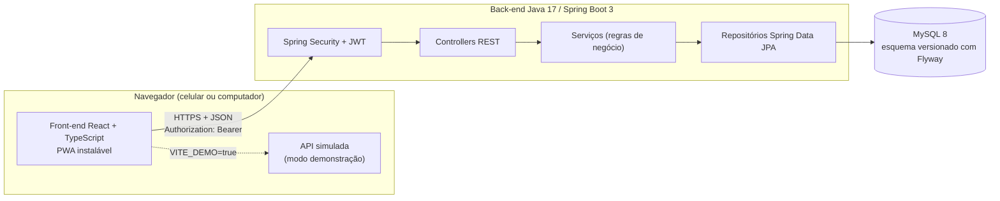

# FatecLab: arquitetura

## Visão geral



É uma aplicação em três camadas: front-end SPA publicado como site estático, API REST stateless e
banco relacional. Front-end e back-end são publicados separadamente e se comunicam por HTTPS, com
CORS configurado no back-end.

## Tecnologias

| Camada | Tecnologia | Uso |
|---|---|---|
| Front-end | React 18, TypeScript 5, Vite 5 | Interface SPA |
| | React Router 6 | Navegação entre telas |
| | lucide-react | Ícones |
| | Chakra Petch e IBM Plex Sans (Fontsource) | Tipografia, servida junto com o app (funciona sem internet) |
| | Vitest, Testing Library | Testes automatizados |
| Back-end | Java 17, Spring Boot 3.2 | API REST |
| | Spring Security, jjwt 0.12 | Autenticação stateless com JWT |
| | Spring Data JPA (Hibernate 6) | Persistência |
| | Flyway | Migrações do banco |
| | Bean Validation | Validação das requisições |
| | Lombok | Redução de código repetitivo nas entidades |
| | JUnit 5, MockMvc, H2 | Testes de unidade, contrato e integração |
| Banco | MySQL 8 | Produção e desenvolvimento |
| Infra | Docker, Render, Vercel, Aiven | Hospedagem gratuita (ver `implantacao.md`) |

O banner do TG-I citava "Front-end: XML", que é a forma de montar telas de aplicativos Android
nativos. O projeto seguiu com React, como já indicava a arquitetura do banner: com um único código,
o sistema roda no navegador do computador, no navegador do celular e instalado como app (PWA).

## Organização do código

```
fateclab/
├── backend/                      API Spring Boot
│   └── src/main/java/br/edu/fatec/fateclab/
│       ├── auth/                 cadastro, login, perfil (Usuario)
│       ├── trilha/               trilhas e módulos (catálogo)
│       ├── progresso/            início de trilha, conclusão de módulo, XP, ofensiva
│       ├── quiz/                 lição, questões, alternativas, correção
│       ├── ranking/              ranking geral
│       ├── perfil/               resumo do aluno e conquistas
│       ├── admin/                manutenção de trilhas
│       ├── gamificacao/          regras puras: nível, conquistas, fuso horário
│       ├── config/               segurança, JWT, CORS, tratamento de erros
│       ├── saude/                verificação de disponibilidade
│       └── shared/               exceções e formato de erro
├── frontend/                     SPA React
│   └── src/
│       ├── pages/                telas (Login, ListaTrilhas, DetalheTrilha, Licao, Ranking, Perfil, Admin)
│       ├── components/           moldura do celular, layout, mapa em circuito, Markdown
│       ├── services/             chamadas à API e tipos
│       ├── demo/                 API simulada e dados do modo demonstração
│       ├── hooks/                sessão e carregamento de dados
│       └── styles/               sistema visual (cores, tipografia, componentes base)
├── conteudo/trilhas.mjs          fonte única do conteúdo de demonstração
└── docs/                         esta documentação
```

Cada pacote do back-end segue o mesmo desenho: `Controller` (HTTP) → `Service` (regras e
transação) → `Repository` (banco), com DTOs (`record`) na fronteira da API. As entidades JPA nunca
são serializadas diretamente.

## Decisões técnicas

1. **JWT stateless:** o token carrega id, e-mail e papel. O servidor não guarda sessão, o que
   simplifica a hospedagem (o serviço pode ser reiniciado a qualquer momento sem derrubar os alunos).
2. **Esquema versionado com Flyway e Hibernate só validando (`ddl-auto: validate`):** cada mudança no
   banco é um script numerado e revisável. Os dados de demonstração ficam numa pasta separada
   (`db/seed`), fora dos testes, e podem ser desligados em produção.
3. **Conversão para DTO dentro da transação:** com `open-in-view` desligado, módulos e questões
   (carregados sob demanda) são lidos dentro dos métodos `@Transactional` dos serviços. Isso evita
   `LazyInitializationException` e consultas escondidas na camada web.
4. **Correção do quiz no servidor:** a lição é enviada sem o gabarito. A verificação de cada
   questão e o envio final são corrigidos no back-end, que também decide a aprovação, o bônus, a
   ofensiva e o avanço do módulo.
5. **Regras de gamificação isoladas (`gamificacao/`):** nível e conquistas são funções puras,
   fáceis de testar e iguais no back-end e no front-end (`lib/gamificacao.ts`).
6. **Edição de trilhas casando módulos pela ordem:** o administrador pode corrigir títulos, lições e
   questões sem perder o progresso dos alunos; excluir um módulo em uso é bloqueado.
7. **Modo demonstração:** a variável `VITE_DEMO=true` troca as chamadas HTTP por uma API simulada
   no navegador (`src/demo/mockApi.ts`), que reproduz as mesmas regras do back-end. Serve como plano
   B na apresentação e permite publicar uma prévia sem servidor.
8. **Aplicativo simulado na web (PWA):** o mesmo código atende computador e celular. Em telas largas,
   o app aparece dentro de uma moldura de smartphone; em telas pequenas, ocupa a tela toda e pode ser
   instalado pelo navegador ("Adicionar à tela inicial").

## Segurança

- Senhas com BCrypt; o hash nunca sai da API.
- JWT HS256 com segredo vindo de `FATECLAB_JWT_SECRET` e expiração configurável.
- Regras de acesso no `SecurityConfig`: `/api/auth/**` e `/api/saude` públicos, `/api/admin/**`
  só para `ADMINISTRADOR`, o restante autenticado. O front-end apenas esconde o que o aluno não pode
  usar; quem decide é sempre o servidor.
- Domínio de e-mail, ordem de módulos e correção do quiz validados no back-end.
- O conteúdo das lições é renderizado como elementos React, sem `innerHTML`: um texto cadastrado
  pelo administrador não consegue executar scripts.
- CORS restrito às origens configuradas em `FATECLAB_CORS_ORIGENS`.

## Qualidade

- **Back-end:** testes unitários (regras de progresso, ranking, nível, ofensiva, aprovação), de
  contrato (status e formato de cada endpoint) e de integração (fluxos completos com banco H2 em modo
  MySQL). Execução: `mvn test`.
- **Front-end:** 32 testes de telas, regras e API simulada com Vitest e Testing Library, mais ESLint
  e checagem de tipos do TypeScript. Execução: `npm run test`, `npm run lint`, `npm run build`.

## Observabilidade

Os serviços registram em log (SLF4J/Logback) os eventos de negócio: cadastro, login, início de
trilha, conclusão de módulo (com XP), quiz respondido (acertos e aprovação) e alterações feitas pelo
administrador. Erros inesperados são registrados com a pilha completa e devolvidos ao cliente como
mensagem genérica, sem expor detalhes internos.
