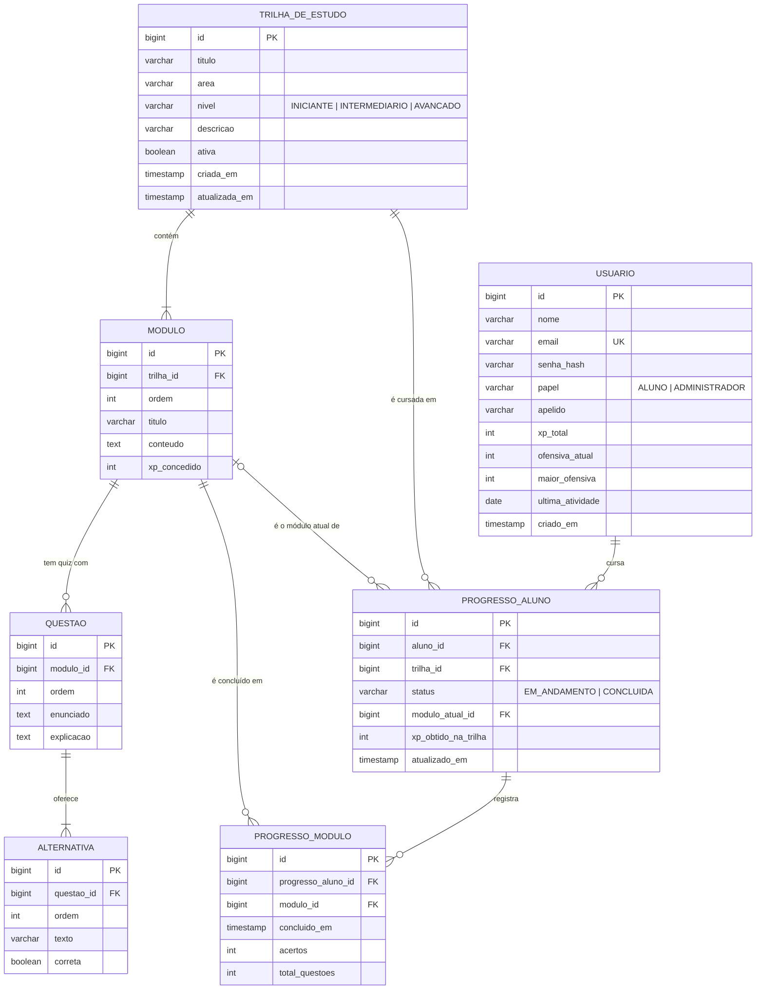

# FatecLab: modelo de dados

Banco relacional MySQL 8, com esquema versionado pelo Flyway em
`backend/src/main/resources/db/migration` (V1 a V4). Os dados de demonstração ficam separados em
`db/seed` (V4_1 e V4_2) e podem ser desligados por variável de ambiente.

## Diagrama entidade-relacionamento

## Dicionário de dados

### usuario

Alunos e administradores. O papel define as permissões.

| Coluna | Tipo | Nulo | Descrição |
|---|---|---|---|
| id | BIGINT, auto incremento | Não | Chave primária. |
| nome | VARCHAR(255) | Não | Nome completo. |
| email | VARCHAR(255), único | Não | E-mail institucional usado no login. |
| senha_hash | VARCHAR(255) | Não | Hash BCrypt da senha. |
| papel | VARCHAR(20) | Não | `ALUNO` ou `ADMINISTRADOR`. |
| apelido | VARCHAR(100) | Sim | Nome exibido no ranking (alunos). |
| xp_total | INT, padrão 0 | Não | XP acumulado, mantido de forma denormalizada para o ranking. |
| ofensiva_atual | INT, padrão 0 | Não | Dias seguidos de estudo na sequência mais recente. |
| maior_ofensiva | INT, padrão 0 | Não | Recorde de dias seguidos. |
| ultima_atividade | DATE | Sim | Último dia (fuso de São Paulo) com módulo concluído. |
| criado_em | TIMESTAMP | Não | Data de cadastro. |

Índices: `uk_usuario_email` (único), `idx_usuario_papel_xp` (ranking).

### trilha_de_estudo

| Coluna | Tipo | Nulo | Descrição |
|---|---|---|---|
| id | BIGINT, auto incremento | Não | Chave primária. |
| titulo | VARCHAR(255) | Não | Nome da trilha. |
| area | VARCHAR(100) | Não | Área de conhecimento (ex.: Banco de Dados). |
| nivel | VARCHAR(20) | Não | `INICIANTE`, `INTERMEDIARIO` ou `AVANCADO`. |
| descricao | VARCHAR(500) | Sim | Resumo exibido no catálogo. |
| ativa | BOOLEAN, padrão verdadeiro | Não | Falso quando removida pelo administrador (remoção lógica). |
| criada_em / atualizada_em | TIMESTAMP | Não | Auditoria. |

Índice: `idx_trilha_area_nivel` (filtros do catálogo).

### modulo

| Coluna | Tipo | Nulo | Descrição |
|---|---|---|---|
| id | BIGINT, auto incremento | Não | Chave primária. |
| trilha_id | BIGINT, FK → trilha_de_estudo | Não | Trilha a que pertence. |
| ordem | INT | Não | Posição na trilha; única por trilha (`uk_modulo_trilha_ordem`). |
| titulo | VARCHAR(255) | Não | Título do módulo. |
| conteudo | TEXT | Sim | Lição em Markdown simplificado. |
| xp_concedido | INT | Não | XP ganho ao concluir. |

### questao

| Coluna | Tipo | Nulo | Descrição |
|---|---|---|---|
| id | BIGINT, auto incremento | Não | Chave primária. |
| modulo_id | BIGINT, FK → modulo | Não | Módulo dono do quiz. |
| ordem | INT | Não | Ordem de apresentação. |
| enunciado | TEXT | Não | Pergunta. |
| explicacao | TEXT | Sim | Mostrada depois da resposta. |

### alternativa

| Coluna | Tipo | Nulo | Descrição |
|---|---|---|---|
| id | BIGINT, auto incremento | Não | Chave primária. |
| questao_id | BIGINT, FK → questao | Não | Questão a que pertence. |
| ordem | INT | Não | Ordem de exibição (A, B, C...). |
| texto | VARCHAR(500) | Não | Texto da alternativa. |
| correta | BOOLEAN | Não | Exatamente uma por questão (validado pela aplicação). |

### progresso_aluno

Um registro por par aluno × trilha (`uk_progresso_aluno_trilha`).

| Coluna | Tipo | Nulo | Descrição |
|---|---|---|---|
| id | BIGINT, auto incremento | Não | Chave primária. |
| aluno_id | BIGINT, FK → usuario | Não | Aluno. |
| trilha_id | BIGINT, FK → trilha_de_estudo | Não | Trilha. |
| status | VARCHAR(20) | Não | `EM_ANDAMENTO` ou `CONCLUIDA`. |
| modulo_atual_id | BIGINT, FK → modulo | Sim | Próximo módulo a cursar; nulo quando a trilha foi concluída. |
| xp_obtido_na_trilha | INT | Não | XP ganho nesta trilha. |
| atualizado_em | TIMESTAMP | Não | Última atualização. |

### progresso_modulo

Histórico de módulos concluídos (`uk_progresso_modulo_par`: um registro por módulo e progresso).

| Coluna | Tipo | Nulo | Descrição |
|---|---|---|---|
| id | BIGINT, auto incremento | Não | Chave primária. |
| progresso_aluno_id | BIGINT, FK → progresso_aluno | Não | Progresso na trilha. |
| modulo_id | BIGINT, FK → modulo | Não | Módulo concluído. |
| concluido_em | TIMESTAMP | Não | Data e hora da conclusão. |
| acertos | INT | Sim | Acertos no quiz que concluiu o módulo (nulo sem quiz). |
| total_questoes | INT | Sim | Total de questões do quiz (nulo sem quiz). |

## Decisões de modelagem

- **XP denormalizado em `usuario.xp_total`:** o ranking é a consulta mais frequente. Somar o histórico a cada acesso seria caro; o total é atualizado na mesma transação que registra a conclusão.
- **Remoção lógica de trilhas (`ativa`):** preserva o progresso e o XP já conquistados pelos alunos.
- **Nível e conquistas calculados, não armazenados:** derivam do XP e do histórico, então não há risco de ficarem inconsistentes.
- **Ofensiva com data local:** `ultima_atividade` é um `DATE` no fuso de São Paulo, para que "dias seguidos" corresponda ao calendário do aluno, e não ao UTC do servidor.
